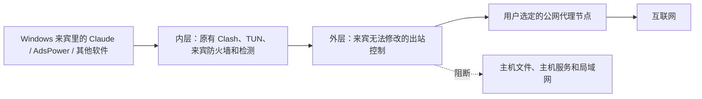

# Cage 参考与双重防护方案

本次沿用用户原有的 **Windows 来宾＋Clash Verge Rev＋AdsPower 专用环境**。保留已有订阅与手动节点选择、节点地区和时区设置、原有软件使用方式及当前安装助手界面。Cage 作为隔离设计和验收机制的参考，不将项目改造成 Cage 工作台，也不为套用源码改用 Linux 客机。

## 本次参考的版本和范围

2026-11-16 查看 `Lee-xeo/Claude-Cage` 的 main，记录提交为 [`4732227482a530de880fa4bf21e035e64d6cb891`](https://github.com/Lee-xeo/Claude-Cage/tree/4732227482a530de880fa4bf21e035e64d6cb891)。这是选定模块的源码研读，没有运行或实机验收 Cage，不是对其整个项目作安全认证。

| 查看范围 | 源码中的机制 | 本项目吸收方式 |
|---|---|---|
| [外部出站门禁](https://github.com/Lee-xeo/Claude-Cage/blob/4732227482a530de880fa4bf21e035e64d6cb891/internal/cage/gate.go) | 门禁由宿主侧持有，默认关闭；检测后限时授权，配置变更或授权到期会撤销已有连接 | 在原模式外补充独立的宿主侧约束。来宾不能凭修改自己的防火墙或返回一个“通过”字段打开外层 |
| [网络目的地策略](https://github.com/Lee-xeo/Claude-Cage/blob/4732227482a530de880fa4bf21e035e64d6cb891/internal/netguard/netguard.go) | 检查本地、私网、保留地址及部分 IPv6 内嵌 IPv4 情况；连接时读取当前宿主网卡地址，读取失败不当作安全 | 补上主机各地址、局域网、链路本地、IPv6 和 DNS 变化的检查。公网端点过滤只是准备步骤，不能代替真实边界 |
| [代理与 DNS](https://github.com/Lee-xeo/Claude-Cage/blob/4732227482a530de880fa4bf21e035e64d6cb891/internal/cage/egress.go) | 业务连接与 DNS 使用指定代理；代理连接失败不会改为直连 | 保留来宾 Clash，但在外层限制出站并检查实际链路；DNS 与代理失败场景也要验收 |
| [检测证据约束](https://github.com/Lee-xeo/Claude-Cage/blob/4732227482a530de880fa4bf21e035e64d6cb891/internal/cage/safety.go) | 报告绑定运行实例、配置及时间；缺少、过期、重复或未通过的必需项不能授权 | 本项目区分外层隔离、内层防护和浏览器业务验收，任何一层待确认都不标成环境就绪 |
| [Windows 数据通道](https://github.com/Lee-xeo/Claude-Cage/blob/4732227482a530de880fa4bf21e035e64d6cb891/internal/workbench/windows_network.go)及[客机检查](https://github.com/Lee-xeo/Claude-Cage/blob/4732227482a530de880fa4bf21e035e64d6cb891/internal/workbench/windows_safety.go) | 当前 Windows 路线检查没有普通 Hyper-V 网卡；通过专用通道接入受控网络栈 | 学习“只有一条受控通路”的原则。其 Hyper-V 通道不能直接套到 VirtualBox / Workstation；不同平台分别适配，不假装共用 NAT 就实现了同样隔离 |
| [文件边界](https://github.com/Lee-xeo/Claude-Cage/blob/4732227482a530de880fa4bf21e035e64d6cb891/internal/mounts/safety.go) | 限制共享用户目录、凭据目录、程序自身与管理数据；还存在项目共享及写入防护机制 | 本项目默认不建立项目共享或磁盘映射。安装文件由主机按清单定向传送，返回固定格式的少量报告 |

与本项目不同，Cage 的上述出站模块将上游凭据留在宿主。本项目按原需求保留来宾 Clash 配置时，所选节点凭据会进入来宾，不能宣称它对来宾管理员保密。不会因此共享主机完整订阅、浏览器配置或主机用户目录。

## 保留原模式的两层设计

1. **内层完整保留。** 保留 Clash Verge Rev、相关服务与 TUN、Windows 来宾出站默认拒绝及必要的精确放行、出口地区 / 固定 IP 检查、停止代理与恢复检查、浏览器 DNS / WebRTC / 时区检查。没有因学习 Cage 而删除现有来宾防护。
2. **外层新增且独立。** 最终出站决定权在来宾之外。各平台优先评估原生可验证的控制；原生能力不足时再评估独立受控网关。不能仅关闭来宾剪贴板或依赖 NAT 便称为完成。已加入用户态受控网关及 VirtualBox UDP 通道适配代码；真实端口保护、网卡回读和来宾绕过测试尚未验收，不把代码或离线测试写成已部署结果。
3. **按平台分别验收。** Hyper-V、VirtualBox、VMware 分别检查网卡、路由、集成功能与外部策略。无法建立等价隔离时，对应方案保持待适配 / 不可部署，不暗中换成另一个平台。
4. **两层状态分别展示。** 外层隔离通过、内层保护通过、浏览器业务验收完成是三组独立结果。旧报告不能代替重启、恢复或换节点后的新证据。启动、节点变更和控制进程失效时要先阻断再重新检查；已加入绑定本次运行和配置摘要的租约、撤销连接及应用退出断网代码；平台持续回读和真实启动 / 恢复链路仍待实机验收。
5. **其他软件联网需求继续支持。** 可按用户需求增加内层的特定程序 / 目的地规则，但仍须通过外层边界。不得通过“允许所有出站”、共享主机代理或放通整个局域网解决问题。需要访问主机或局域网属于改变隔离范围，不能仍宣称保持同等严格隔离。

## 必须额外排查的信息通道

不能只检查网络。Hyper-V 的 KVP 数据交换可通过 VMbus 向来宾提供宿主描述信息，不需要网卡；应检查是否有宿主名称等字段，限制不必要的数据交换并处理缓存，同时验证安装器管理通道仍正常。见[微软 KVP 说明](https://learn.microsoft.com/en-us/windows-server/virtualization/hyper-v/integration-services-data-exchange)。VirtualBox Guest Additions 也有宿主 / 来宾属性通道，见[Oracle Guest Additions 文档](https://docs.oracle.com/en/virtualization/virtualbox/7.2/user/guestadditions.html)。

VMware Tools、Hyper-V 增强会话重定向、共享剪贴板、文件拖放、USB / 设备直通、安装应答文件和浏览器 / 云账号同步均属于独立检查项。研究 Cage 时查看到的模块不能证明这些通道已全部阻断。

这里的安全目标是阻止读取主机私人文件、访问未授权主机服务与局域网，并在规定场景阻止绕过代理。不能保证隐藏虚拟化事实、所有 CPU 特征、公开互联网信息或本人复用账号产生的关联，也不能保证虚拟机逃逸漏洞不存在。

## 来源、致谢及前一轮结果

Cage 项目主许可为 [MIT](https://github.com/Lee-xeo/Claude-Cage/blob/4732227482a530de880fa4bf21e035e64d6cb891/LICENSE)，另有 [NOTICE 和第三方条款](https://github.com/Lee-xeo/Claude-Cage/blob/4732227482a530de880fa4bf21e035e64d6cb891/NOTICE)。本次保留的是设计研读与来源记录，没有将 Cage 实现代码复制进本安装器。后续若实质引入其代码，须保留对应版权和许可、记录来源及修改，不能继续宣称该部分完全独立原创。用户提供的早期交流材料作为项目背景保留，不据此作开发先后或权属判定。

现阶段：原来宾方案保留；已加入外层网关、VirtualBox 接入、主机端口规则及回读、租约控制、应用启动入口拦截、注册虚拟机扫描。网关策略和内存中的 TCP 数据包测试通过，实际部署继续拦截；Hyper-V / Workstation 等价外层适配、真实端口生效、来宾绕过测试及干净机器实测尚未完成。离线测试和编译结果不能替代这些验收，不发布完整自动化或隔离已通过的结论。

## 镜像安装与通用规则的补充参考

继续研读 Cage 固定提交中的 [Windows 介质选择](https://github.com/Lee-xeo/Claude-Cage/blob/4732227482a530de880fa4bf21e035e64d6cb891/internal/hostimage/source.go)、[微软目录解析](https://github.com/Lee-xeo/Claude-Cage/blob/4732227482a530de880fa4bf21e035e64d6cb891/internal/hostimage/windows_catalog.go) 和 [下载校验](https://github.com/Lee-xeo/Claude-Cage/blob/4732227482a530de880fa4bf21e035e64d6cb891/internal/hostimage/download.go)，吸收如下原则：

| 规则 | 本项目处理与边界 |
|---|---|
| 干净的官方安装介质 | 使用微软官方介质，不克隆开发者的个人系统盘，不封装已登录账号、浏览器资料或真实订阅。当前仍使用已核验的微软媒体创建工具；尚未接通其目录自动解析 |
| 匹配系统身份 | 应核对 CPU 架构、Windows 版本 / 版本号、语言和镜像索引，再选本次专用介质。本 EXE 目前仅支持 Windows 11 x64；按目录自动匹配完整身份仍待实现，不宣称已有 Mac 客户端 |
| 校验来源与完整性分别记录 | 资源目录包含固定 SHA-256；用户本地 ISO 的计算值只作本地指纹，不能当作微软公布值或官方来源证明 |
| 介质格式适配平台 | ESD 是映像容器，不能改后缀冒充可启动 ISO。Hyper-V 的离线应用、VirtualBox / Workstation 的启动安装需分别实现和验收；暂不照抄 Cage 为其特定媒体设定的 HTTP 下载例外 |
| 安装前先建立边界 | 新 VirtualBox 初始网卡全部关闭；启用时只连接受控通道，不先用 NAT 上网再补规则。未选节点的原型路径维持全网卡禁用 |
| 默认关闭与失效撤销 | 从宿主控制通路续期，绑定 VM / 运行 / 节点摘要；失败不切换直连。新网关只拨号到固定公网节点，DNS 不使用宿主系统解析器 |
| 重启先核对，保留内层 | 冷启动、保存状态恢复与切换节点必须重新检查；原 Clash 服务、TUN、防火墙和浏览器验收保持独立，不能以旧记录代替当前结果 |

VirtualBox 的 UDPTunnel `dest` 仅指定发往何处，不能限制其入站监听。已根据 [Oracle 网络文档](https://docs.oracle.com/en/virtualization/virtualbox/7.2/user/networkingdetails.html) 及 [UDP 驱动源码](https://github.com/VirtualBox/virtualbox/blob/main/src/VBox/Devices/Network/DrvUDPTunnel.cpp) 增加按虚拟机端口、VirtualBox 进程限定的非回环入站阻断原型。使用 [VirtualBox 信息输出](https://github.com/VirtualBox/virtualbox/blob/main/src/VBox/Frontends/VBoxManage/VBoxManageInfo.cpp) 时发现机器可读输出省略通道属性，因此另外使用 API 回读，不能仅看到 Generic 便放行。

来宾 DNS 代理选择语法按 [Mihomo DNS 文档](https://wiki.metacubex.one/en/config/dns/) 配置。代码与文档核对不代表实际 Windows 防火墙、UDP 隧道、Clash 核心版本与 DNS 路径已经通过联合实测。

## 2026-11-17 三平台接入与镜像识别更新

前一轮“Hyper-V / Workstation 待适配、实际部署继续拦截”已由本轮代码更新：Hyper-V 无普通网卡，走认证的 Hyper-V Socket；Workstation 无普通网卡，走认证的 VMCI / vSockets。来宾使用官方未修改的 Wintun 适配器接入同一受控网关；原 Clash 服务、TUN、防火墙和检查完整保留。通道双向认证绑定 VM、任务、平台、端口与 MAC，不提供命令或共享文件协议。依据平台公开接口独立实现，没有复制 Cage 源码。

Windows 仍通过微软媒体创建工具取得完整 ISO，没有接通 Cage 的微软目录下载实现；现已增加 ISO 内版本、架构、索引只读识别与选择，拒绝不支持的镜像，按实际版本显示使用授权提醒。读取身份、文件哈希、官方来源、许可证和激活是不同事实，不互相冒充。

[完整接通与验证记录](完整部署接通与验证_2026-11-17.md)列出当前已实现代码及剩余实机验收；不能将离线检查写成干净机器部署或安全认证已完成。
